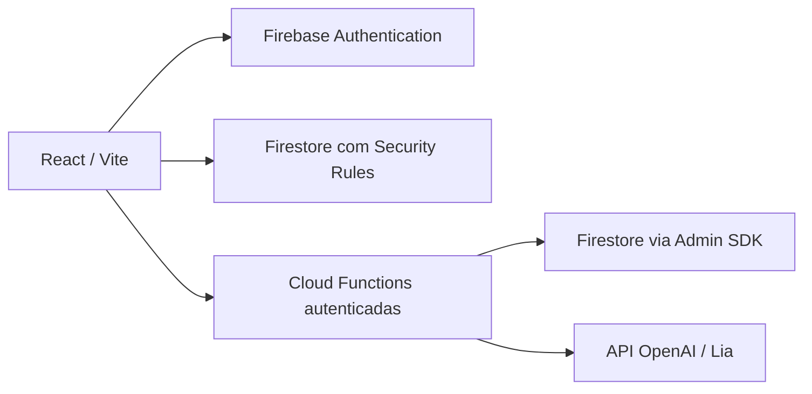

# Arquitetura

## Escopo desta entrega

Somente estrutura de diretórios, documentação e exemplos de ambiente. Não há código de aplicação, manifests de dependências, regras implantáveis, workflows ou serviços configurados. Scripts de desenvolvimento, build e testes serão adicionados na implementação.

## Fluxo planejado

O frontend consulta os dados autorizados diretamente no Firestore. Operações privilegiadas, vínculos, transições de atendimento e conversas da Lia passam pelas Functions. O Admin SDK ignora Security Rules; por isso cada Function deve validar identidade, perfil, propriedade e payload.

## Organização do frontend

| Pasta | Responsabilidade |
| --- | --- |
| `assets` | Imagens, fontes e arquivos estáticos |
| `components/ui` | Componentes visuais reutilizáveis |
| `components/layouts` | Estrutura de navegação dos perfis |
| `components/charts` | Gráficos com Recharts |
| `pages/auth` | Entrada e recuperação de acesso |
| `pages/admin` | Gestão de usuários, vínculos e indicadores |
| `pages/doctor` | Pacientes vinculados, acompanhamento e fila |
| `pages/patient` | Gestação, linha do tempo, histórico e Lia |
| `features` | Regras e fluxos organizados por domínio |
| `services/firebase` | Inicialização dos SDKs e emuladores |
| `services/api` | Adaptadores para Functions e persistência |
| `hooks` | Hooks compartilhados |
| `contexts` | Sessão e estado global mínimo |
| `routes` | Rotas protegidas e redirecionamento por perfil |
| `types` | Tipos e contratos compartilhados no frontend |
| `utils` | Funções puras, datas e formatação |

Páginas compõem componentes e features. Features acessam os serviços; componentes visuais não consultam Firebase diretamente. Evitar abstrações extras até existir necessidade concreta.

## Organização do backend

- `controllers`: entrada das Functions, validação dos contratos e tradução de erros.
- `middlewares`: verificações reutilizáveis de autenticação e autorização para handlers callable.
- `services`: casos de uso, persistência e integração OpenAI.
- `index.ts` futuro: inicialização e exportação das Functions, sem regras de negócio.

## Perfis e navegação

Após autenticação, carregar o perfil confiável e direcionar `admin` para `/admin`, `doctor` para `/doctor` e `patient` para `/patient`. Usuários sem perfil ficam sem acesso até provisionamento. Guardas de rota ajudam a interface; autorização real ocorre nas regras e no backend. Não permitir seleção ou alteração de perfil pelo próprio usuário.

## Lia

Conversas educativas e acolhedoras em português, contextualizadas pela fase gestacional. Não realizar diagnósticos, prescrições ou substituir profissionais. Definir instruções de segurança no servidor, tratar conteúdo da conversa como entrada não confiável e orientar a busca de atendimento quando apropriado. A implementação dessas proteções e sua validação ficam para a próxima etapa.

Usar a Responses API no backend, segredo no Secret Manager, contexto mínimo necessário, limites de entrada/saída, controle de frequência e tratamento de falhas. Não registrar conversas ou dados de saúde em logs. Planejar consentimento, retenção e exclusão antes de utilizar dados reais.

Referência de integração: [OpenAI Responses API](https://developers.openai.com/api/reference/typescript/resources/responses/methods/create).

## Ferramentas a configurar

Frontend: React, React DOM, React Router, Firebase Web SDK, Lucide React e Recharts. Desenvolvimento: Vite, TypeScript, Tailwind CSS, ESLint, Vitest, Testing Library e Firebase CLI. Backend: Firebase Admin, Firebase Functions, OpenAI SDK e um validador de payloads. Fixar versões compatíveis e gerar lockfile na inicialização.

Scripts previstos: `dev`, `build`, `typecheck`, `lint`, `test`, `test:rules`, `emulators` e `build:functions`. CI deverá executar instalação reproduzível, lint, verificação de tipos, testes e build. Testes de regras devem provar o isolamento entre pacientes, médicos e administradores; testes do backend devem cobrir autorizações e transições inválidas.
